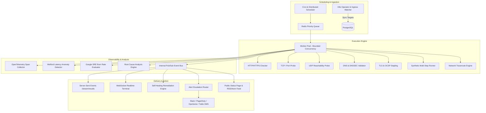

# ⚡ PulseGrid

> **Enterprise-Grade Distributed Uptime & Synthetic Monitoring Platform**  
> Built with Go 1.22+, PostgreSQL, Redis, Prometheus, and Kubernetes Operator.

[](https://golang.org)
[](LICENSE)
[](deploy/docker-compose.yml)
[](deploy/helm/pulsegrid)
[](internal/tracing)

---

## 📖 Table of Contents

- [Overview](#-overview)
- [Architecture](#-architecture)
- [Core Features](#-core-features)
  - [High-Throughput Bounded Concurrency Worker Pool](#high-throughput-bounded-concurrency-worker-pool)
  - [Multi-Protocol Probing Engines](#multi-protocol-probing-engines)
  - [Multi-Step Synthetic User Journeys](#multi-step-synthetic-user-journeys)
  - [Google SRE Multi-Window Burn-Rate SLO Engine](#google-sre-multi-window-burn-rate-slo-engine)
  - [Network Path Visualizer & Hop-by-Hop Traceroute](#network-path-visualizer--hop-by-hop-traceroute)
  - [Real-Time SSE & WebSocket Streaming](#real-time-sse--websocket-streaming)
  - [Automated Self-Healing Remediation](#automated-self-healing-remediation)
  - [OpenTelemetry Tracing & Waterfall Visualizer](#opentelemetry-tracing--waterfall-visualizer)
  - [Multi-Tenant RBAC & JWT Authentication](#multi-tenant-rbac--jwt-authentication)
  - [Kubernetes Operator & Helm Automation](#kubernetes-operator--helm-automation)
  - [Public Status Pages, Subscribers & RSS/Atom Feeds](#public-status-pages-subscribers--rssatom-feeds)
- [Quick Start](#-quick-start)
- [CLI Reference](#-cli-reference)
- [REST API Matrix](#-rest-api-matrix)
- [Testing & Benchmarking](#-testing--benchmarking)
- [License](#-license)

---

## 🔭 Overview

**PulseGrid** is an intermediate-to-advanced uptime monitoring and synthetic transaction service engineered in Go. It empowers reliability engineering (SRE) teams to schedule, probe, analyze, and alert on tens of thousands of targets with strictly bounded resource usage.

PulseGrid eliminates blind spots through multi-region consensus verification, hop-by-hop network path diagnosis, SSL/TLS certificate revocation tracking (OCSP), HTTP security header grading (A+ to F), automated incident escalation policies, and self-healing webhooks.

---

## 🏛 Architecture



---

## 🚀 Core Features

### High-Throughput Bounded Concurrency Worker Pool
Executes tens of thousands of probes without goroutine leaks. Backed by dynamic worker autoscaling, context timeout enforcement, and memory-safe buffer recycling.

### Multi-Protocol Probing Engines
- **HTTP / HTTPS**: Full response assertion (body regex, status codes, response headers).
- **TCP / Port**: Connection handshake and payload echo validation.
- **UDP**: Reachability testing with ICMP port-unreachable detection.
- **DNS & DNSSEC**: Record lookup, validation of RRSIG cryptographic signatures, and DNSSEC chain validation.
- **TLS & OCSP Stapling**: SSL expiration alerts, certificate revocation verification via OCSP stapling and CRL.
- **HTTP Security Headers Auditor**: Automated audit and A+ to F grading for HSTS, CSP, X-Frame-Options, and Permissions-Policy.

### Multi-Step Synthetic User Journeys
Test critical user workflows (login -> extract JWT -> call API -> checkout) with JSONPath extraction and runtime variable interpolation.

### Google SRE Multi-Window Burn-Rate SLO Engine
Implements standard multi-window burn rate alerts directly out of the Google SRE Handbook:
- **1-Hour Window (14.4x Burn Rate)**: Consumes 2% error budget in 1 hour -> PagerDuty Critical.
- **6-Hour Window (6.0x Burn Rate)**: Consumes 5% error budget in 6 hours -> High severity alert.
- **24-Hour / 3-Day Window (3.0x / 1.0x Burn Rate)**: Error budget depletion alerts dispatched to ticket queues.
- Real-time time-to-exhaustion forecasts in hours.

### Network Path Visualizer & Hop-by-Hop Traceroute
Identifies intermediate ISP packet loss, BGP route flaps, and router latency degradation across transit hops before total downtime occurs.

### Real-Time SSE & WebSocket Streaming
Live streaming check execution results via Server-Sent Events (`/api/v1/stream/results`) and full-duplex WebSockets for real-time status dashboards and CLI feeds.

### Automated Self-Healing Remediation
Configurable webhooks and cloud function triggers triggered automatically on outage detection, protected by cooldown circuit breakers to prevent flapping reboot loops.

### OpenTelemetry Tracing & Waterfall Visualizer
End-to-end distributed trace spans for every probe phase (DNS resolution, TCP connect, TLS handshake, TTFB, and response transfer) with Prometheus metrics bridge.

### Multi-Tenant RBAC & JWT Authentication
Hierarchical access control:
- **Viewer**: Read-only status inspection and metrics dashboards.
- **Operator**: Target management and on-demand synthetic execution.
- **Admin**: Alert routing, quiet hours, and SLO configuration.
- **Owner**: Full tenant administration and API key rotation.

### Kubernetes Operator & Helm Automation
- Custom Resource Definition (`ProbeTarget`) for declarative monitoring infrastructure.
- Ingress annotation auto-discovery: annotate any Kubernetes Ingress with `pulsegrid.io/monitor: "true"` for zero-touch configuration.
- Helm charts ready for one-command cluster installation.

### Public Status Pages, Subscribers & RSS/Atom Feeds
- Component group aggregation (Operational, Degraded, Partial Outage, Major Outage).
- Email & webhook subscription management.
- Live RSS 2.0 (`/status/feed.rss`) and Atom (`/status/feed.atom`) incident publication feeds.

---

## ⚡ Quick Start

### 1. Run with Docker Compose

```bash
git clone https://github.com/sujanv/PulseGrid.git
cd PulseGrid
docker-compose up -d
```

### 2. Verify Services

- **Web Dashboard**: [http://localhost:8080](http://localhost:8080)
- **Public Status Page**: [http://localhost:8080/status](http://localhost:8080/status)
- **Prometheus Metrics**: [http://localhost:8080/metrics](http://localhost:8080/metrics)
- **Health Probes**: [http://localhost:8080/healthz](http://localhost:8080/healthz)

---

## 💻 CLI Reference

PulseGrid includes an enterprise CLI tool for immediate probes, network diagnostics, and on-demand testing:

```bash
# Execute immediate single HTTP probe
./bin/pulsegrid-cli check https://example.com --timeout=5

# Execute hop-by-hop traceroute network diagnostic
./bin/pulsegrid-cli traceroute example.com

# Calculate Google SRE error budget and time-to-exhaustion
./bin/pulsegrid-cli slo-calc tgt-payment-service

# Run SSL and HTTP security headers audit (A+ to F grade)
./bin/pulsegrid-cli audit https://api.pulsegrid.io

# Execute multi-step synthetic transaction
./bin/pulsegrid-cli synthetic ./examples/synthetic-checkout.json

# Export 30-day SLA performance report
./bin/pulsegrid-cli export
```

---

## 📡 REST API Matrix

| Method | Endpoint | Description |
|---|---|---|
| `GET` | `/api/v1/targets` | List all monitored targets |
| `POST` | `/api/v1/targets` | Register a new target |
| `GET` | `/api/v1/targets/:id` | Get target details |
| `GET` | `/api/v1/targets/:id/results` | Historical check results |
| `GET` | `/api/v1/targets/:id/stats` | P50, P95, P99 Latency & Uptime % |
| `GET` | `/api/v1/targets/:id/traces` | OpenTelemetry waterfall spans |
| `GET` | `/api/v1/network/traceroute?host=...` | Hop-by-hop network path diagnosis |
| `GET` | `/api/v1/slo/burn-rate?target_id=...` | Multi-window burn-rate error budget |
| `POST` | `/api/v1/synthetics/run` | Execute on-demand synthetic workflow |
| `GET` | `/api/v1/stream/results` | Server-Sent Events (SSE) live results |
| `POST` | `/api/v1/remediation/:id` | Configure automated remediation action |
| `GET` | `/api/v1/statuspage/components` | Component status summary |
| `GET` | `/status/feed.rss` | RSS 2.0 incident feed |
| `GET` | `/status/feed.atom` | Atom XML incident feed |
| `GET` | `/badge/:target_id.svg` | Dynamic SVG Uptime Badge |
| `GET` | `/healthz` | Kubernetes liveness probe |
| `GET` | `/metrics` | Prometheus metrics scrape endpoint |

---

## 🧪 Testing & Benchmarking

```bash
# Run unit and race condition tests
go test -v -race ./...

# Run concurrency stress benchmark test
go test -v -bench=. ./test/stress_test.go
```

---

## 📄 License

MIT License. See [LICENSE](LICENSE) for details.
