# ⚡ PulseGrid

> **Enterprise Distributed Synthetic & Uptime Monitoring Engine**  
> Engineered in Go 1.22+ with Bounded-Concurrency Goroutine Pools, Google SRE Error Budget Tracking, W3C HAR 1.2 Exporter, Automated Canary Analysis, Chaos Fault Injection, Core Web Vitals, and Kubernetes Native Automation.

[](https://golang.org)
[](LICENSE)
[](deploy/docker-compose.yml)
[](deploy/helm/pulsegrid)
[](internal/tracing)

---

## 📖 Table of Contents

- [Overview](#-overview)
- [System Architecture](#-system-architecture)
- [Key Enterprise Features](#-key-enterprise-features)
  - [High-Throughput Bounded Concurrency Worker Pool](#high-throughput-bounded-concurrency-worker-pool)
  - [Multi-Protocol Probing Engines](#multi-protocol-probing-engines)
  - [Synthetic Browser Core Web Vitals (CWV) Profiler](#synthetic-browser-core-web-vitals-cwv-profiler)
  - [RFC 1889 / 3550 Inter-Arrival Jitter Profiler](#rfc-1889--3550-inter-arrival-jitter-profiler)
  - [GeoDNS Multi-Vantage Steering Verification](#geodns-multi-vantage-steering-verification)
  - [Automated ACME Let's Encrypt Certificate Lifecycle](#automated-acme-lets-encrypt-certificate-lifecycle)
  - [Prometheus Remote-Write Time Series Exporter](#prometheus-remote-write-time-series-exporter)
  - [Calendar-Aware On-Call Schedule Rotation](#calendar-aware-on-call-schedule-rotation)
  - [Production Grafana 1-Click Dashboard JSON](#production-grafana-1-click-dashboard-json)
  - [OpenTelemetry Span Linking for Outage Chains](#opentelemetry-span-linking-for-outage-chains)
  - [W3C HAR 1.2 HTTP Archive Exporter](#w3c-har-12-http-archive-exporter)
  - [Automated Canary Analysis (ACA) & Progressive Rollouts](#automated-canary-analysis-aca--progressive-rollouts)
  - [Google SRE Multi-Window Multi-Burn-Rate SLO Engine](#google-sre-multi-window-multi-burn-rate-slo-engine)
  - [Dynamic Adaptive Sampling](#dynamic-adaptive-sampling)
  - [Alert De-duplication & Failure Domain Correlation](#alert-de-duplication--failure-domain-correlation)
  - [Bi-directional PagerDuty v2 Sync & Chat Webhooks](#bi-directional-pagerduty-v2-sync--chat-webhooks)
  - [Kubernetes Operator & Helm Deployment](#kubernetes-operator--helm-deployment)
- [Getting Started](#-getting-started)
- [CLI Reference](#-cli-reference)
- [REST API Matrix](#-rest-api-matrix)
- [Testing & Quality Assurance](#-testing--quality-assurance)
- [License](#-license)

---

## 🔭 Overview

**PulseGrid** is an enterprise synthetic and uptime monitoring service built in Go. It empowers Site Reliability Engineering (SRE) and platform teams to schedule, probe, diagnose, and auto-remediate thousands of distributed targets with strictly bounded resource usage.

PulseGrid eliminates monitoring blind spots by combining multi-region quorum consensus, synthetic browser user journeys with cookie persistence, Core Web Vitals profiling, RFC 1889 network jitter measurement, W3C HAR 1.2 exporting, deep X.509 certificate authority inspection, mTLS zero-trust probing, hop-by-hop network path diagnosis, and Google SRE multi-window burn rate alerts.

---

## 🏛 System Architecture

```mermaid
flowchart TD
    subgraph Ingestion & Scheduling
        Cron[Distributed Scheduler / Cron] --> Q[Redis Priority Queue]
        K8s[Kubernetes Ingress & CRD Watcher] -->|Sync Targets| PG[(PostgreSQL)]
        AM[Prometheus Alertmanager Hook] --> Correlator[Infra Correlator]
    end

    subgraph Probing Engine [Bounded Concurrency Worker Pool]
        Q --> WP[Worker Pool]
        WP --> ChkHTTP[HTTP/HTTPS Assertion]
        WP --> ChkGRPC[gRPC Health Check Protocol]
        WP --> ChkWS[WebSocket Stream Heartbeat]
        WP --> ChkMTLS[mTLS Zero-Trust Probing]
        WP --> ChkCert[X.509 SAN & Expiration Inspector]
        WP --> ChkJitter[RFC 1889 Jitter Profiler]
        WP --> ChkGeoDNS[GeoDNS Policy Steering]
        WP --> ChkVitals[Core Web Vitals Evaluator]
        WP --> ChkScen[Synthetic Scenario Runner]
        WP --> ChkTrace[Hop-by-Hop Traceroute]
    end

    subgraph Consensus & Analysis
        WP --> GeoQuorum[Geo-Matrix Consensus]
        WP --> FlapDampener[Flap Dampener - Hysteresis]
        WP --> Sampler[Adaptive Sampling Engine]
        WP --> OTel[OpenTelemetry Span Collector & Linker]
        WP --> SLO[Google SRE Burn Rate Evaluator]
        WP --> Canary[Automated Canary Analyzer]
        WP --> RCA[RCA & Post-Mortem Generator]
        WP --> Bus[Pub/Sub Event Bus]
    end

    subgraph Delivery & Action
        Bus --> SSE[SSE /api/v1/stream/results]
        Bus --> Rem[Self-Healing Remediation]
        Bus --> Dedup[Alert Deduplication & Correlation]
        Dedup --> OnCall[On-Call Rotation Dispatcher]
        OnCall --> PagerDuty[PagerDuty v2 Auto-Resolve]
        OnCall --> Teams[Microsoft Teams Adaptive Cards]
        OnCall --> Discord[Discord Rich Embeds]
        Bus --> RemoteWrite[Prometheus Remote-Write]
        Bus --> Grafana[Grafana 1-Click Dashboards]
        Bus --> Badge[Dynamic SVG / JSON Badges]
        Bus --> StatusPage[Public Status Page & RSS/Atom]
    end
```



---

## 🚀 Key Enterprise Features

### High-Throughput Bounded Concurrency Worker Pool
- Bounded concurrency worker pool preventing goroutine leaks or out-of-memory crashes under massive target load.
- Backpressure rejection and graceful shutdown with Go `context.Context` cancellation.

### Multi-Protocol Probing Engines
- **HTTP / HTTPS**: Full response assertion (body regex, status codes, headers, and latency bounds).
- **gRPC Health Checking Protocol**: Standard `grpc.health.v1.Health/Check` status verification (`SERVING`, `NOT_SERVING`, `UNKNOWN`).
- **WebSocket Streaming Heartbeat**: Bi-directional streaming connection probe measuring handshake and ping/pong turnaround latency.
- **TCP / UDP / DNS / DNSSEC / TLS**: Deep network reachability, cryptographic RRSIG signature validation, and OCSP stapling revocation.

### Synthetic Browser Core Web Vitals (CWV) Profiler
- Automatically profiles front-end web targets for Google Core Web Vitals:
  - **Largest Contentful Paint (LCP)**: `<2.5s` (Good), `2.5s-4.0s` (Needs Improvement), `>4.0s` (Poor).
  - **First Input Delay (FID) / INP**: `<100ms` (Good), `100ms-300ms` (Needs Improvement), `>300ms` (Poor).
  - **Cumulative Layout Shift (CLS)**: `<0.10` (Good), `0.10-0.25` (Needs Improvement), `>0.25` (Poor).
  - **Time to First Byte (TTFB)**: `<800ms`.

### RFC 1889 / 3550 Inter-Arrival Jitter Profiler
- Measures smoothed inter-arrival packet dispersion and latency deviation:
  $$\Delta(i, j) = (R_j - S_j) - (R_i - S_i)$$
  $$J = J + rac{|\Delta(i, j)| - J}{16}$$
- Reports Min, Mean, Max RTT, and RFC 1889 smoothed jitter alongside percentage packet loss.

### GeoDNS Multi-Vantage Steering Verification
- Simulates DNS queries from multiple regional vantage points (`us-east`, `eu-west`, `ap-south`) to verify that queries resolve to the expected regional IP prefixes, catching silent edge DNS routing misconfigurations.

### Automated ACME Let's Encrypt Certificate Lifecycle
- Tracks SSL/TLS certificates through automated ACME challenge stages (`http-01`, `dns-01`) and triggers preemptive renewal workflows 30 days before expiration.

### Prometheus Remote-Write Time Series Exporter
- Native Prometheus Remote-Write client (`internal/exporter/remote_write.go`) pushing probe metrics directly to Cortex, Thanos, M3DB, or VictoriaMetrics clusters without scraping overhead.

### Calendar-Aware On-Call Schedule Rotation
- Configurable on-call rotation manager (`internal/alert/oncall_rotation.go`) supporting daily and weekly rotation handovers, secondary escalation fallbacks, and timezone-aware shifts.

### Production Grafana 1-Click Dashboard JSON
- Generates compliant Grafana dashboard models (`internal/integrations/grafana.go`) featuring panels for SLO burn rate gauges, P95/P99 latency percentiles, and target uptime percentages.

### OpenTelemetry Span Linking for Outage Chains
- Links dependent service failure spans across microservice architectures, allowing SRE teams to trace cascading outages back to the root cause dependency.

### W3C HAR 1.2 HTTP Archive Exporter
- Export synthetic scenario runs as standard W3C HAR 1.2 JSON files ready for immediate import into Chrome DevTools, Charles Proxy, and Postman.

### Automated Canary Analysis (ACA) & Progressive Rollouts
- Automated canary evaluator comparing error rate delta and P95/P99 latency regressions between baseline and canary targets, delivering clear `PROMOTE`, `HALT`, or `ROLLBACK` rollout recommendations.

### Google SRE Multi-Window Multi-Burn-Rate SLO Engine
Implements the Google SRE Handbook Chapter 5 standard multi-window burn rate alerts:
- **1-Hour Window (14.4x Burn Rate)**: Consumes 2% error budget in 1 hour &rarr; PagerDuty Critical paging.
- **6-Hour Window (6.0x Burn Rate)**: Consumes 5% error budget in 6 hours &rarr; High severity alert.
- **24-Hour / 3-Day Window (3.0x / 1.0x Burn Rate)**: 10% budget consumed &rarr; Engineering ticket alert.
- Computes remaining downtime budget in minutes and real-time **Time-to-Exhaustion** in hours.

---

## ⚡ Getting Started

### 1. Launch with Docker Compose

```bash
git clone https://github.com/sujanv/PulseGrid.git
cd PulseGrid
docker-compose up -d
```

### 2. Verify Services

- **Web Dashboard**: [http://localhost:8080](http://localhost:8080)
- **Public Status Page**: [http://localhost:8080/status](http://localhost:8080/status)
- **Live SVG Badge**: [http://localhost:8080/badge/live/badge.svg](http://localhost:8080/badge/live/badge.svg)
- **Prometheus Metrics**: [http://localhost:8080/metrics](http://localhost:8080/metrics)
- **Kubernetes Health**: [http://localhost:8080/healthz](http://localhost:8080/healthz)

---

## 💻 CLI Reference

PulseGrid includes a command-line interface for probes, synthetic journeys, network diagnostics, and post-mortems:

```bash
# Execute immediate single probe
./bin/pulsegrid-cli check https://example.com --timeout=5

# Measure RFC 1889 network jitter and latency dispersion
./bin/pulsegrid-cli jitter-probe api.pulsegrid.io

# Profile Google Core Web Vitals (LCP, FID, CLS)
./bin/pulsegrid-cli webvitals https://pulsegrid.io

# Export Grafana production dashboard JSON
./bin/pulsegrid-cli grafana-export

# Deep inspect SSL/TLS certificate and SAN chain
./bin/pulsegrid-cli cert-inspect api.pulsegrid.io

# Export synthetic scenario to W3C HAR 1.2 JSON
./bin/pulsegrid-cli har-export ./examples/user-journey.json

# Evaluate progressive canary rollout vs baseline
./bin/pulsegrid-cli canary-eval baseline-api canary-api

# Execute hop-by-hop traceroute network diagnostic
./bin/pulsegrid-cli traceroute example.com

# Calculate Google SRE error budget and time-to-exhaustion
./bin/pulsegrid-cli slo-calc tgt-payment-service

# Generate automated incident post-mortem markdown
./bin/pulsegrid-cli postmortem-gen INC-1001

# Evaluate multi-region quorum consensus
./bin/pulsegrid-cli geo-quorum tgt-payment-service

# Run SSL and HTTP security headers audit (A+ to F grade)
./bin/pulsegrid-cli audit https://api.pulsegrid.io

# Export 30-day SLA performance report to CSV
./bin/pulsegrid-cli export
```

---

## 📡 REST API Matrix

| Method | Endpoint | Description |
|---|---|---|
| `GET` | `/api/v1/targets` | List all monitored targets |
| `POST` | `/api/v1/targets` | Register a new target |
| `GET` | `/api/v1/targets/:id/results` | Historical check results |
| `GET` | `/api/v1/targets/:id/stats` | P50, P95, P99 Latency & Uptime % |
| `POST` | `/api/v1/synthetic/web-vitals` | Profile Core Web Vitals (LCP, FID, CLS) |
| `GET` | `/api/v1/integrations/grafana/dashboard` | 1-Click Grafana production dashboard |
| `GET` | `/badge/live/:id.svg` | Dynamic SVG Uptime and Latency Badge |
| `POST` | `/api/v1/targets/har/export` | Export synthetic scenario to W3C HAR 1.2 |
| `POST` | `/api/v1/canary/evaluate` | Automated Canary Analysis (ACA) decision |
| `GET` | `/api/v1/network/traceroute?host=...` | Hop-by-hop network path diagnosis |
| `GET` | `/api/v1/slo/burn-rate?target_id=...` | Multi-window burn-rate error budget |
| `POST` | `/api/v1/scenarios/run` | Execute browser-like multi-step scenario |
| `GET` | `/api/v1/incidents/postmortem?id=...` | Generate SRE incident post-mortem markdown |
| `POST` | `/api/v1/integrations/alertmanager` | Ingest Prometheus Alertmanager webhook |
| `GET` | `/api/v1/stream/results` | Server-Sent Events (SSE) live results |
| `POST` | `/api/v1/remediation/:id` | Configure automated remediation action |
| `GET` | `/status/feed.rss` | RSS 2.0 incident feed |
| `GET` | `/status/feed.atom` | Atom XML incident feed |
| `GET` | `/healthz` | Kubernetes liveness probe |
| `GET` | `/metrics` | Prometheus metrics scrape endpoint |

---

## 🧪 Testing & Quality Assurance

```bash
# Run all unit and integration tests
go test -v ./...

# Run tests with race condition detection
go test -v -race ./...

# Run concurrency benchmarks
go test -v -bench=. ./test/stress_test.go
```

---

## 📄 License

MIT License. See [LICENSE](LICENSE) for details.
