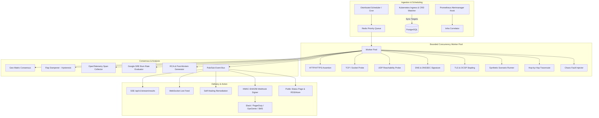

# ⚡ PulseGrid

> **Enterprise Distributed Synthetic & Uptime Monitoring Engine**  
> Engineered in Go 1.22+ with Bounded-Concurrency Goroutine Pools, Google SRE Error Budget Tracking, Chaos Fault Injection, and Kubernetes Native Automation.

[](https://golang.org)
[](LICENSE)
[](deploy/docker-compose.yml)
[](deploy/helm/pulsegrid)
[](internal/tracing)

---

## 📖 Table of Contents

- [Overview](#-overview)
- [System Architecture](#-system-architecture)
- [Key Enterprise Features](#-key-enterprise-features)
  - [High-Throughput Bounded Concurrency Worker Pool](#high-throughput-bounded-concurrency-worker-pool)
  - [Multi-Protocol Probing Engines](#multi-protocol-probing-engines)
  - [Browser-Like Multi-Step Synthetic Scenarios](#browser-like-multi-step-synthetic-scenarios)
  - [Google SRE Multi-Window Multi-Burn-Rate SLO Engine](#google-sre-multi-window-multi-burn-rate-slo-engine)
  - [Geo-Matrix Consensus & Exponential Flap Dampening](#geo-matrix-consensus--exponential-flap-dampening)
  - [Chaos Engineering & Synthetic Fault Injection](#chaos-engineering--synthetic-fault-injection)
  - [Automated SRE Incident Post-Mortem & Timeline Generator](#automated-sre-incident-post-mortem--timeline-generator)
  - [Cryptographic Webhook HMAC-SHA256 Signing](#cryptographic-webhook-hmac-sha256-signing)
  - [Prometheus Alertmanager Infrastructure Correlation](#prometheus-alertmanager-infrastructure-correlation)
  - [Hop-by-Hop Traceroute & Route Flap Analyzer](#hop-by-hop-traceroute--route-flap-analyzer)
  - [Real-Time SSE & WebSocket Streaming](#real-time-sse--websocket-streaming)
  - [Self-Healing Webhook Remediation Circuit](#self-healing-webhook-remediation-circuit)
  - [Multi-Tenant RBAC & JWT Authorization](#multi-tenant-rbac--jwt-authorization)
  - [Kubernetes Operator & Helm Deployment](#kubernetes-operator--helm-deployment)
- [Getting Started](#-getting-started)
- [CLI Reference](#-cli-reference)
- [REST API Matrix](#-rest-api-matrix)
- [Testing & Quality Assurance](#-testing--quality-assurance)
- [License](#-license)

---

## 🔭 Overview

**PulseGrid** is an enterprise-grade synthetic and uptime monitoring service built in Go. It empowers reliability engineering (SRE) and platform teams to schedule, probe, diagnose, and auto-remediate thousands of distributed targets with strictly bounded resource usage.

PulseGrid eliminates monitoring blind spots by combining multi-region quorum consensus, synthetic browser user journeys with cookie persistence, hop-by-hop network path diagnosis, SSL/TLS certificate revocation tracking (OCSP stapling), HTTP security header grading (A+ to F), and Google SRE multi-window burn rate alerts.

---

## 🏛 System Architecture



---

## 🚀 Key Enterprise Features

### High-Throughput Bounded Concurrency Worker Pool
- Bounded concurrency worker pool preventing goroutine leaks or out-of-memory crashes under massive target load.
- Backpressure rejection and graceful shutdown with Go `context.Context` cancellation.

### Multi-Protocol Probing Engines
- **HTTP / HTTPS**: Full response assertion (body regex, status codes, headers, and latency bounds).
- **TCP / Port**: Connection handshake and socket ping.
- **UDP**: Reachability probe with ICMP port-unreachable detection.
- **DNS & DNSSEC**: Record lookup, cryptographic RRSIG signature validation, and root-trust chain checking.
- **TLS & OCSP Stapling**: SSL expiration alerts, certificate revocation verification via OCSP stapling and CRL.
- **HTTP Security Headers Auditor**: Automated audit and A+ to F grading for HSTS, CSP, X-Frame-Options, and Permissions-Policy.

### Browser-Like Multi-Step Synthetic Scenarios
- Multi-step transaction runner (`internal/synthetic/scenario.go`) with session cookie jar persistence across steps.
- Automatic redirect chain tracking (up to 10 hops) and step-by-step performance waterfall metrics (DNS, Connect, TLS, TTFB, and Transfer).
- DOM & HTML selector matcher (`internal/synthetic/dom_matcher.go`) supporting `#id`, `.class`, tags, and regex extraction.

### Google SRE Multi-Window Multi-Burn-Rate SLO Engine
Implements the Google SRE Handbook Chapter 5 standard multi-window burn rate alerts:
- **1-Hour Window (14.4x Burn Rate)**: Consumes 2% error budget in 1 hour &rarr; PagerDuty Critical paging.
- **6-Hour Window (6.0x Burn Rate)**: Consumes 5% error budget in 6 hours &rarr; High severity alert.
- **24-Hour / 3-Day Window (3.0x / 1.0x Burn Rate)**: 10% budget consumed &rarr; Engineering ticket alert.
- Computes remaining downtime budget in minutes and real-time **Time-to-Exhaustion** in hours.

### Geo-Matrix Consensus & Exponential Flap Dampening
- **Geo-Matrix Evaluator** (`internal/consensus/geo_matrix.go`): Distinguishes between localized CDN edge degradation and global origin outages.
- **Flap Dampener** (`internal/consensus/flap_dampener.go`): Exponential decay hysteresis suppresses alert flapping storms while services rapidly oscillate during recovery.

### Chaos Engineering & Synthetic Fault Injection
- Synthetic fault injection engine (`internal/chaos/fault_injector.go`) simulates latency spikes, packet loss, and HTTP 500/503 status overrides.
- **Blast Radius Protection**: Strict environment checks prevent running chaos experiments against production targets; enforces max percentage limits.

### Automated SRE Incident Post-Mortem & Timeline Generator
- Auto-generates GitHub-flavored Markdown post-mortem documents (`internal/rca/postmortem.go`) aggregating root causes, affected regions, chronological timeline events, and action items.
- Reliability metrics calculator (`internal/rca/metrics.go`): Calculates MTTD (Mean Time to Detect), MTTR (Mean Time to Resolve), total downtime in minutes, and error budget impact.

### Cryptographic Webhook HMAC-SHA256 Signing
- Signs outbound alert webhooks (`internal/alert/webhook_signer.go`) using `HMAC-SHA256(secret, payload)`.
- Generates `X-PulseGrid-Signature: sha256=<hex>` and `X-PulseGrid-Timestamp: <unix>` headers with anti-replay tolerance checking.

### Prometheus Alertmanager Infrastructure Correlation
- Built-in webhook receiver (`internal/integrations/alertmanager.go`) accepts alerts from Prometheus Alertmanager clusters to correlate CPU/memory infrastructure spikes with external probe outages.

### Hop-by-Hop Traceroute & Route Flap Analyzer
- Visualizes ICMP/TCP hops to the destination, highlighting transit packet loss and intermediate ISP latency spikes.
- Detects route flapping between consecutive traces to isolate upstream BGP and transit path instability.

### Real-Time SSE & WebSocket Streaming
- Stream live check execution results via Server-Sent Events (`/api/v1/stream/results`) and full-duplex WebSockets for real-time operations dashboards.

### Self-Healing Webhook Remediation Circuit
- Automated webhook and cloud run action trigger on confirmed incident transitions.
- Protected by cooldown circuit breakers and execution rate limiters to prevent runaway reboot loops.

### Multi-Tenant RBAC & JWT Authorization
- Fine-grained role hierarchy: `Viewer`, `Operator`, `Admin`, and `Owner`.
- JWT token service with cryptographic HMAC-SHA256 signing and tenant isolation context.

### Kubernetes Operator & Helm Deployment
- Custom Resource Definition (`ProbeTarget`) for declarative GitOps monitoring.
- Ingress auto-discovery watcher: annotate Ingress objects with `pulsegrid.io/monitor: "true"` for zero-touch configuration.

---

## ⚡ Getting Started

### 1. Launch with Docker Compose

```bash
git clone https://github.com/sujanv/PulseGrid.git
cd PulseGrid
docker-compose up -d
```

### 2. Verify Services

- **Web Dashboard**: [http://localhost:8080](http://localhost:8080)
- **Public Status Page**: [http://localhost:8080/status](http://localhost:8080/status)
- **Prometheus Metrics**: [http://localhost:8080/metrics](http://localhost:8080/metrics)
- **Kubernetes Health**: [http://localhost:8080/healthz](http://localhost:8080/healthz)

---

## 💻 CLI Reference

PulseGrid includes a command-line interface for probes, synthetic journeys, network diagnostics, and post-mortems:

```bash
# Execute immediate single probe
./bin/pulsegrid-cli check https://example.com --timeout=5

# Execute browser-like multi-step user journey
./bin/pulsegrid-cli scenario-run ./examples/user-journey.json

# Execute hop-by-hop traceroute network diagnostic
./bin/pulsegrid-cli traceroute example.com

# Calculate Google SRE error budget and time-to-exhaustion
./bin/pulsegrid-cli slo-calc tgt-payment-service

# Generate automated incident post-mortem markdown
./bin/pulsegrid-cli postmortem-gen INC-1001

# Evaluate multi-region quorum consensus
./bin/pulsegrid-cli geo-quorum tgt-payment-service

# Run SSL and HTTP security headers audit (A+ to F grade)
./bin/pulsegrid-cli audit https://api.pulsegrid.io

# Export 30-day SLA performance report to CSV
./bin/pulsegrid-cli export
```

---

## 📡 REST API Matrix

| Method | Endpoint | Description |
|---|---|---|
| `GET` | `/api/v1/targets` | List all monitored targets |
| `POST` | `/api/v1/targets` | Register a new target |
| `GET` | `/api/v1/targets/:id/results` | Historical check results |
| `GET` | `/api/v1/targets/:id/stats` | P50, P95, P99 Latency & Uptime % |
| `GET` | `/api/v1/targets/:id/traces` | OpenTelemetry waterfall execution spans |
| `GET` | `/api/v1/network/traceroute?host=...` | Hop-by-hop network path diagnosis |
| `GET` | `/api/v1/slo/burn-rate?target_id=...` | Multi-window burn-rate error budget |
| `POST` | `/api/v1/scenarios/run` | Execute browser-like multi-step scenario |
| `GET` | `/api/v1/incidents/postmortem?id=...` | Generate SRE incident post-mortem markdown |
| `POST` | `/api/v1/integrations/alertmanager` | Ingest Prometheus Alertmanager webhook |
| `GET` | `/api/v1/stream/results` | Server-Sent Events (SSE) live results |
| `POST` | `/api/v1/remediation/:id` | Configure automated remediation action |
| `GET` | `/api/v1/statuspage/components` | Component status summary |
| `GET` | `/status/feed.rss` | RSS 2.0 incident feed |
| `GET` | `/status/feed.atom` | Atom XML incident feed |
| `GET` | `/badge/:target_id.svg` | Dynamic SVG Uptime Badge |
| `GET` | `/healthz` | Kubernetes liveness probe |
| `GET` | `/metrics` | Prometheus metrics scrape endpoint |

---

## 🧪 Testing & Quality Assurance

```bash
# Run all unit and integration tests
go test -v ./...

# Run tests with race condition detection
go test -v -race ./...

# Run concurrency benchmarks
go test -v -bench=. ./test/stress_test.go
```

---

## 📄 License

MIT License. See [LICENSE](LICENSE) for details.
